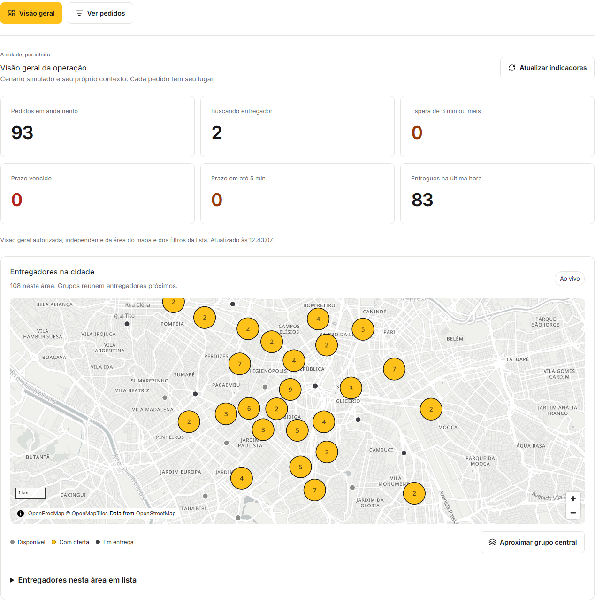

# Bora

Despacho de entregas em tempo real em São Paulo, com Java, Spring Boot, React e PostGIS.
Uma loja cria o pedido, o sistema busca um entregador pelo tempo de rota e a operação acompanha
cada etapa até a entrega. A demonstração mantém 120 entregadores e 40 lojas fictícias em atividade.

**[Abrir demonstração](https://bora.alexandregaia.me/)** ·
**[Como funciona](https://bora.alexandregaia.me/como-funciona)**



[Ver a operação em movimento](docs/imagens/operacao.gif).

## Explore a operação em cerca de 2 minutos

O roteiro usa pedidos do cenário simulado e permite conhecer o sistema sem criar uma entrega.

1. Abra a [área da operação](https://bora.alexandregaia.me/operacao) e escolha **Operação** para
   entrar. Observe os indicadores e os entregadores no mapa.
2. Escolha **Ver pedidos**. Em **Mostrar**, selecione **Cenário simulado**; em
   **Status do pedido**, escolha **Entregue**.
3. Abra um pedido e confira seu prazo e a linha do tempo. Copie o código do pedido.
4. Volte à lista, cole o código completo em **Código do pedido** e escolha **Buscar pedido**.
   A busca respeita os filtros e diferencia maiúsculas de minúsculas.

Para participar, a [loja](https://bora.alexandregaia.me/loja) permite escolher um destino,
criar um pedido e abrir seu rastreio. Na [área do entregador](https://bora.alexandregaia.me/entregador),
o pedido de treino oferece um percurso só seu: aceite, comande a direção simulada e confirme
a coleta e a entrega. É possível pausar e retomar. O [passo a passo](https://bora.alexandregaia.me/como-funciona)
explica os controles e o código próprio do treino.

O código usado na busca identifica o pedido. O código de confirmação da entrega tem outra
função e não aparece no rastreio público. Use apenas destinos de teste.

## Executar localmente

Pré-requisitos: Git e Docker com Compose. No Windows, mantenha o Docker Desktop aberto com
o mecanismo Linux ativo. Em um terminal PowerShell ou bash:

```sh
git clone https://github.com/coder-gaia/BORA.git
cd BORA
docker compose -f infra/compose/compose.dev.yml up --build --wait
```

Abra [localhost:5173](http://localhost:5173) quando os serviços estiverem prontos. O primeiro
build baixa imagens e dependências e prepara o grafo de ruas; o tempo depende da máquina e
da conexão. Os dados de vias já estão no repositório. Banco, API, simulador e web sobem juntos;
a [readiness](http://localhost:8080/actuator/health/readiness) exige banco e roteamento aquecido.

Os serviços locais escutam somente em `127.0.0.1`. A senha padrão `bora_dev` serve para
desenvolvimento. Para personalizar credenciais ou portas, copie `.env.example` para `.env` e
passe `--env-file .env` antes de `-f` nos comandos Compose.

```sh
docker compose -f infra/compose/compose.dev.yml logs --tail 100
docker compose -f infra/compose/compose.dev.yml down
```

`down` preserva os volumes. As receitas de API e web nativas, verificação, diagnóstico e
ferramentas ficam no [guia de desenvolvimento](docs/desenvolvimento.md).

## Arquitetura e decisões

A API é um monolito modular em Java 25 e Spring Boot 4.1.1. PostgreSQL 18 e PostGIS guardam
pedidos, ofertas, sessões e posições. A busca espacial seleciona candidatos; GraphHopper 11.1
embutido calcula as rotas nas vias reais. Bloqueios e índices únicos protegem a reserva concorrente.

A interface React 19 recebe snapshots por WebSocket e recupera o estado por HTTP após
desconexão. O simulador é um processo Java separado, com threads virtuais e as mesmas ações
HTTP usadas pelos participantes. Duas APIs compartilham o banco atrás do Caddy na implantação
pública; a web é compilada em arquivos estáticos.

O [guia de arquitetura](docs/arquitetura.md) apresenta os componentes e os fluxos. Os ADRs
explicam as escolhas de [módulos](docs/decisoes/0003-monolito-modular.md),
[rotas e reservas](docs/decisoes/0004-rotas-e-reservas.md),
[tempo real](docs/decisoes/0005-tempo-real-e-snapshots.md),
[sessões da demonstração](docs/decisoes/0006-sessoes-e-contextos.md) e
[publicação gradual](docs/decisoes/0002-publicacao-gradual.md).

## Limites e evidências

- O ETA usa velocidades das vias e o ritmo da simulação, sem trânsito em tempo real. A escolha
  compara até oito candidatos próximos. Veja [roteamento](docs/roteamento.md).
- Os ensaios locais aquecidos com quatro CPUs lógicas aprovaram 150 e 500 entregadores, com
  p95 de GPS de 10 e 12 ms. O degrau a frio reprovou. Esses resultados não comprovam capacidade
  equivalente na VM pública; o método e as tentativas ficam em [carga e concorrência](docs/carga.md).
- A demo usa uma única VM Azure ARM64, com 2 vCPUs e 8 GiB. VM e banco são pontos únicos de
  falha; a máquina usa créditos de CPU e a hospedagem depende de créditos estudantis temporários.
  Custos, configuração e recuperação estão em [publicação](docs/deploy.md).
- A substituição gradual das APIs e a troca atômica da CSP têm verificações próprias. Reloads
  estruturais do Caddy podem encerrar conexões TCP; WebSockets precisam reconectar.
- As identidades são temporárias, com isolamento por contexto. A documentação de
  [segurança](docs/seguranca.md) registra proteções e limites; a de
  [qualidade web](docs/qualidade-web.md), testes de navegador, acessibilidade e desempenho.

## Licença

Código sob [MIT](LICENSE). Dados de vias com [licença e atribuição OpenStreetMap](infra/osm/NOTICE.md).
