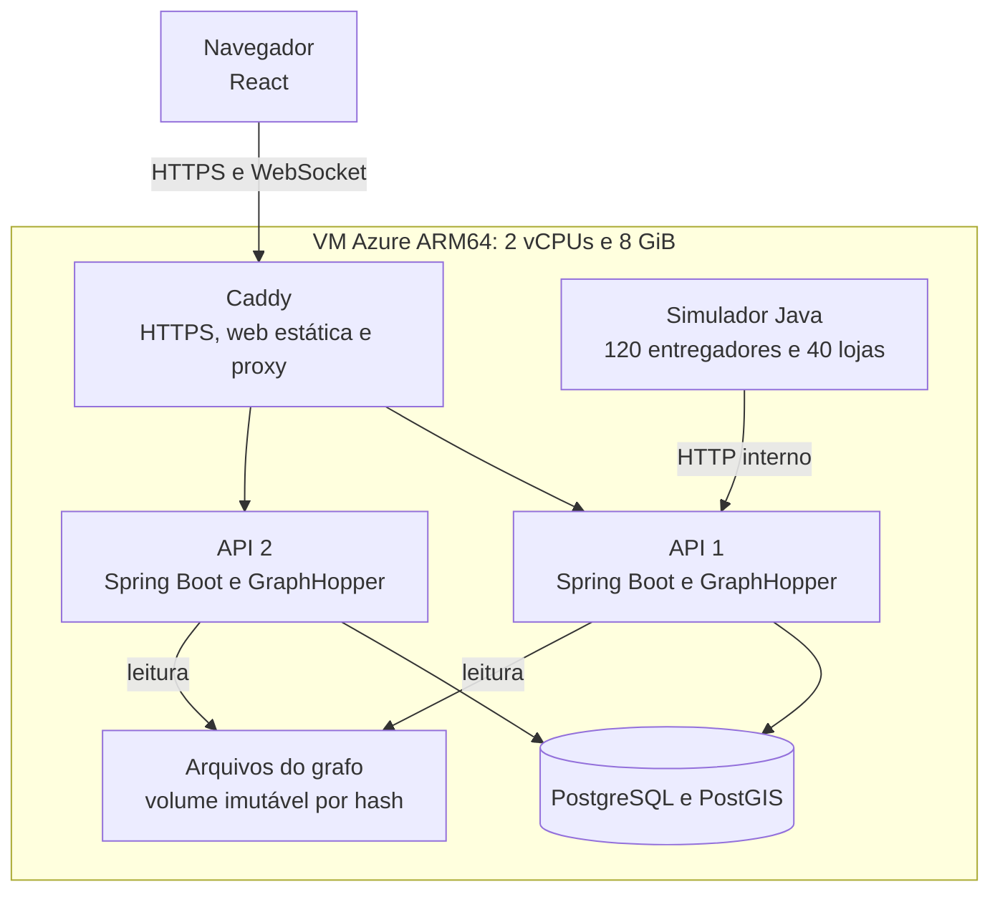
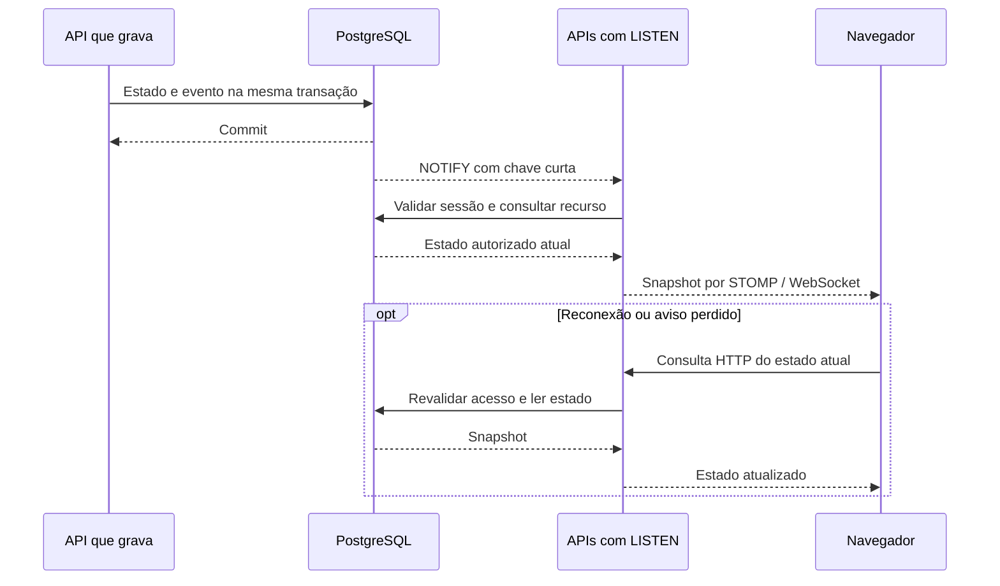

# Arquitetura

O Bora demonstra o ciclo de uma entrega em São Paulo: a loja cria um pedido, o despacho
seleciona um entregador pelo tempo de rota, e a operação acompanha ofertas, coleta e entrega.
A interface React 19 usa uma API Java 25 com Spring Boot 4.1.1. API, web e simulador vivem no
mesmo repositório; o backend é um [monolito modular](decisoes/0003-monolito-modular.md).

## Componentes em execução

Somente o Caddy publica portas de aplicação. As duas APIs compartilham banco, sessões e
arquivos de rotas; cada instância executa seu próprio GraphHopper embutido. Um importador
temporário prepara e aquece o grafo antes da ativação. A readiness exige banco e roteamento
prontos; a liveness acompanha o processo. O simulador usa sessões por ator e as ações HTTP
da aplicação, sem acessar o banco.

O ambiente local usa uma API e Vite; o Compose de cluster reproduz duas APIs e o proxy.
Os comandos ficam no [README](../README.md), no [guia de desenvolvimento](desenvolvimento.md)
e no [guia de publicação](deploy.md).

## Limites dos módulos

Os pacotes sob `dev.bora` expõem contratos públicos e mantêm implementações em `internal`.
O teste `BoraApplicationIT` verifica as fronteiras com Spring Modulith. Os módulos continuam
no mesmo processo e podem participar de uma transação PostgreSQL.

| Módulo                    | Responsabilidade                                                     |
| ------------------------- | -------------------------------------------------------------------- |
| `identity` e `demo`       | Sessões, papéis, contexto privado e limites compartilhados de uso.   |
| `stores` e `orders`       | Lojas, pedidos, estados, histórico e idempotência.                   |
| `couriers`                | Disponibilidade, recepção e persistência de posições em lote.        |
| `dispatch`                | Busca de candidatos, reservas, ofertas, vencimento e redistribuição. |
| `fulfillment`             | Progresso, coleta, confirmação da entrega e liberação do entregador. |
| `routing`                 | Encaixe nas vias, geometria, distância e tempo de rota.              |
| `realtime` e `operations` | Snapshots autorizados, WebSocket e indicadores da operação.          |

`shared` reúne erros comuns, e `web` configura o contrato OpenAPI. O contrato exportado da API
é comparado no CI com o documento versionado e com os tipos TypeScript gerados.

## Como uma oferta é decidida

O PostgreSQL guarda estados, prazos e próxima tentativa. Cada tentativa bloqueia um pedido
com `FOR UPDATE SKIP LOCKED`. PostGIS pré-seleciona até oito entregadores disponíveis e próximos;
GraphHopper calcula o percurso até a loja e o despacho ordena esses candidatos pela duração.
A reserva revalida disponibilidade e geração da posição antes de escolher um único entregador.

Oferta, reserva e evento são gravados na mesma transação. Índices únicos parciais impedem duas
ofertas pendentes para o mesmo pedido ou entregador e duas entregas ativas para um entregador.
O vencimento de 30 segundos fica no banco e pode ser recuperado por outra instância após reinício.
Coleta, cancelamento e redistribuição seguem a mesma ordem de bloqueio dos recursos.

As posições chegam a um buffer limitado e são gravadas em lote. HTTP 202 confirma recepção;
a posição passa a ser compartilhada após persistir. Timestamp e `position_epoch` impedem que
amostras antigas de uma etapa sobrescrevam o estado atual. Esse buffer em memória não é uma
fila durável. Veja [domínio](dominio.md), [entregadores e posições](entregadores-e-posicoes.md)
e a [decisão de rotas e reservas](decisoes/0004-rotas-e-reservas.md).

## Como as telas recebem mudanças

Cada API escuta o PostgreSQL por uma conexão dedicada. Os avisos só chegam depois do commit;
eles aceleram a leitura e não constituem um histórico de mensagens. Reconciliação periódica,
reconexão e snapshots HTTP recuperam alterações perdidas. O mapa envia apenas a área visível,
com no máximo um frame por segundo. Veja [tempo real](tempo-real.md) e a
[decisão de recuperação por snapshots](decisoes/0005-tempo-real-e-snapshots.md).

A sessão fica no PostgreSQL, identificada por cookie HttpOnly. Escritas e conexão STOMP exigem
CSRF. Trocar de papel preserva o contexto do visitante e renova a sessão; sair revoga o contexto.
O servidor autoriza recursos também no WebSocket. O cenário simulado é público; pedidos de
visitantes ficam no próprio contexto, com rastreio limitado por um código aleatório separado
da confirmação da entrega. Veja [identidade e pedidos](identidade-e-pedidos.md) e a
[decisão de sessões e contextos](decisoes/0006-sessoes-e-contextos.md).

A página inicial combina HTML estático hidratado e prévia cartográfica com Canvas. A exploração
carrega MapLibre sob demanda. Detalhes de projeção, interpolação, acessibilidade e medição ficam
em [mapa e interface](mapa-e-interface.md) e [qualidade web](qualidade-web.md).

## Publicação e limites

A publicação substitui uma API por vez com drenagem e readiness. Um marcador bloqueia novas
ofertas enquanto as versões estão misturadas. HTML e CSP são ativados por trocas atômicas de
arquivos, com retenção dos assets anteriores. Alterações estruturais do Caddy ainda exigem
reload e podem encerrar conexões TCP; sockets da API substituída precisam reconectar.
O [guia de publicação](deploy.md) e o [ADR de publicação gradual](decisoes/0002-publicacao-gradual.md)
descrevem o fluxo e a recuperação.

A VM e o banco são pontos únicos de falha. A hospedagem usa créditos estudantis temporários
e a VM tem créditos de CPU. A demonstração mantém 120 entregadores simulados. Os ensaios
locais com 150 e 500 entregadores, em quatro CPUs lógicas e após aquecimento, não comprovam
essa capacidade na VM Azure. O degrau a frio reprovado permanece documentado em
[carga e concorrência](carga.md).

O ETA usa velocidades das vias e o fator de simulação, sem trânsito em tempo real; a escolha
é a melhor entre os candidatos pré-selecionados. O mapa depende de serviços externos para o
estilo e os tiles da exploração. Consulte [roteamento](roteamento.md), [simulação](simulacao.md)
e [segurança e verificações](seguranca.md) para os limites e as evidências de cada área.
