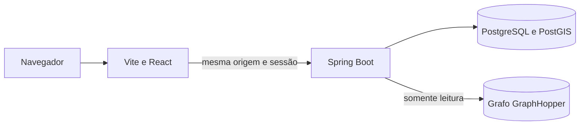
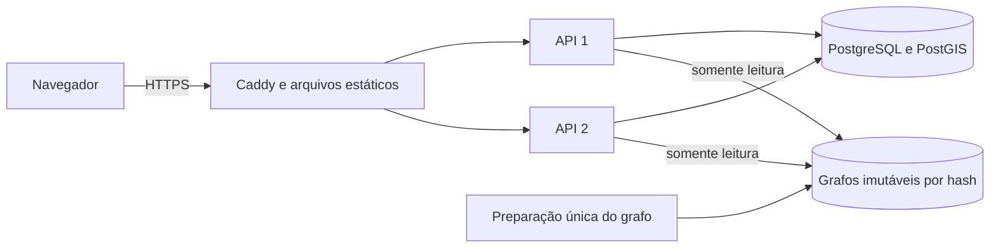

# Arquitetura

Bora mantém API, simulador e interface em um monorepo. O backend evolui como monolito modular,
com transações locais e fronteiras verificáveis. A base atual contém saúde operacional,
máquinas de estado, esquema PostGIS, sessões compartilhadas, pedidos autenticados, histórico
transacional e roteamento embutido. Um processo separado simula lojas e entregadores por HTTP,
com sessões independentes por ator e sem acesso direto ao banco.

O Compose local prepara o grafo em um processo separado, inicia o banco e aguarda PostGIS antes
de iniciar a API e disponibilizar a web. A readiness inclui o banco e o grafo carregado com uma
rota de aquecimento aprovada. A liveness informa a saúde do processo sem depender desses dados.
Os health checks não expõem caminhos do grafo ou detalhes internos do banco.

## Evolução prevista

Os módulos `orders`, `couriers`, `dispatch` e `routing` contêm os primeiros contratos do domínio.
Entidades e escrita transacional de pedidos ficam em `orders.internal`; o teste Modulith
verifica as fronteiras. Os demais módulos serão introduzidos conforme seus comportamentos
existirem. O [guia de domínio](dominio.md) descreve estados, esquema e invariantes.

As decisões que orientam essa evolução são:

- Garantir exclusividade de ofertas e entregas com restrições e transações no PostgreSQL.
- Manter as posições persistidas como fonte compartilhada, com sequência ou instante de coleta
  para rejeitar atualizações antigas entre instâncias.
- Usar notificações do banco como aviso de mudança e recuperar o estado atual ao reconectar.
- Distinguir o cenário público simulado dos dados e ações pertencentes a cada visitante.
- Autorizar cada pedido e assinatura WebSocket conforme o acesso ao recurso.
- Permitir atualização gradual com migrações compatíveis e reconexão automática do tempo real.

Na implantação atual, duas APIs compartilham uma VM e um banco. Essa configuração permite
exercitar concorrência e atualizações graduais, mas a VM continua sendo um ponto único de falha.
Consumo de memória, latência, fluidez do mapa e comportamento durante atualizações serão medidos
com os cenários e as condições de teste registrados na documentação.

## Interface e mapa

A página pública é preparada em HTML estático no build e hidratada por React. A abertura usa
uma imagem real Positron do OpenFreeMap, com data e metadados geográficos associados. Um
Canvas 2D desenha os entregadores simulados recebidos por STOMP ou snapshot HTTP antes de
qualquer exploração. A projeção Mercator acompanha o recorte responsivo da imagem.

**Explorar mapa** carrega MapLibre GL JS 6.15, worker e CSS e abre a navegação interativa na
região visível. A imagem tem nome com hash e preload no HTML; seus metadados são compilados
junto da interface. O navegador interpola posições e respeita visibilidade, movimento reduzido
e pausa visual nos dois modos. Dados de visitantes permanecem sujeitos ao contexto e às
regras de autorização da API.

A linha do tempo deriva os marcos dos estados e eventos persistidos. Redistribuição reinicia a
progressão da tentativa, e cancelamento preserva a distinção entre etapa interrompida e etapas
não realizadas. O [guia de mapa e interface](mapa-e-interface.md) descreve o comportamento,
acessibilidade e limites das medições.

## Publicação

O ambiente de produção serve a web compilada pelo Caddy. Somente o proxy publica portas na VM;
as APIs compartilham uma rede com ele e outra com o banco, que não possui porta pública.

A troca de APIs acontece uma instância por vez, com drenagem e readiness. A web usa ativação
atômica de arquivos e preserva assets anteriores. O fluxo e os limites dessa recuperação estão
no [guia de publicação](deploy.md) e na [decisão de publicação gradual](decisoes/0002-publicacao-gradual.md).

O importador prepara e aquece o grafo antes de mudar o tráfego. Publica um diretório por hash,
mantendo versões anteriores para rollback. As APIs usam GraphHopper embutido e compartilham
esse volume somente para leitura; o cálculo não chama um serviço externo.
O [guia de roteamento](roteamento.md) descreve perfil, dados, ETA e medições.

## Identidade e pedidos

As duas APIs compartilham sessões Spring Session JDBC. O navegador recebe um cookie HttpOnly;
ações exigem o token CSRF obtido da mesma sessão. Trocar de papel preserva o contexto privado
do visitante, com rotação do identificador da sessão e do token. Sair revoga o contexto.

`identity` cuida da identidade; `demo`, dos limites compartilhados com Bucket4j e PostgreSQL;
`stores`, das consultas de loja; `orders`, da criação e do ciclo do pedido. `shared` contém
erros HTTP comuns, sem depender dos módulos do domínio. Os controladores validam o papel e os
serviços voltam a conferir propriedade e contexto. A operação de visitante não recebe pedidos
particulares de outros contextos.

Criar um pedido adquire um lock no contexto antes de conferir o limite de cinco pedidos ativos.
Pedido, evento e registro de idempotência são persistidos na mesma transação. A chave é
compartilhada pelas APIs e uma repetição válida preserva a resposta original. O limitador usa
uma conexão própria, antes de abrir essa transação, para evitar espera circular no pool.

O contrato OpenAPI vem dos controladores reais. Um teste exporta e compara o documento com
o snapshot versionado; o CI também confere os tipos TypeScript derivados desse documento.
Consulte [identidade e pedidos](identidade-e-pedidos.md).

## Entregadores e execução da entrega

`couriers` controla disponibilidade e recebe posições em um buffer limitado. A gravação em
lote no PostgreSQL só substitui uma posição por outra coletada depois dela. O banco é a fonte
compartilhada entre as APIs; uma resposta de recebimento ainda precisa ser confirmada pela
consulta da posição persistida.

`fulfillment` depende das interfaces públicas de `orders` e `couriers`. Coordena chegada por
proximidade, trilha, coleta, código de confirmação e liberação do entregador. Um evento síncrono
de término mantém pedido, evento e liberação na mesma transação. A notificação de posições
acontece depois da gravação do lote; uma reconciliação periódica recupera progresso pelo banco
se essa notificação for perdida. Consulte [entregadores e posições](entregadores-e-posicoes.md).

O módulo também chama a limpeza de reservas de `dispatch` antes de liberar o entregador
atribuído. Cancelamento, expiração, aceite e redistribuição usam a mesma ordem de bloqueio:
pedido, oferta e entregador. Cada tentativa de despacho ou expiração trata somente um pedido
por transação, evitando manter reservas de vários entregadores enquanto aguarda outro pedido.

## Despacho e ofertas

`dispatch` busca pedidos vencidos para tentativa com `FOR UPDATE SKIP LOCKED`. Para cada pedido,
seleciona até oito entregadores próximos pelo índice espacial, calcula rotas e ordena pela duração
simulada exata. O ETA em segundos é arredondado somente para exposição e armazenamento. A
reserva condicional revalida disponibilidade, posição e geração da posição antes de bloquear um
único candidato. Ofertas anteriores aceitas, recusadas ou expiradas para esse pedido excluem o
mesmo entregador das próximas tentativas.

A oferta dura 30 segundos. Aceite e recusa verificam o relógio depois dos bloqueios; uma decisão
tardia confirma a expiração e libera a reserva antes de responder com conflito. Prazo, estado,
tentativa seguinte e eventos ficam no PostgreSQL, compartilhados pelas duas APIs. O reinício de
um processo não depende de temporizadores em memória para recuperar ofertas vencidas.

A criação de novas ofertas exige um marcador de ativação com o SHA completo da própria API
e o proxy no modo `both`. O deploy fecha esse marcador antes de substituir processos e o abre
somente depois de validar APIs e web da mesma versão. A limpeza de reservas continua ativa
durante a atualização e após recuperar a versão anterior. Consulte o
[guia de publicação](deploy.md).

O cliente recebe ofertas e mudanças de pedidos por STOMP, com sessão compartilhada e
autorização do recurso em cada assinatura. As duas APIs recebem avisos transacionais do
PostgreSQL e consultam o estado persistido. Reconexão e reconciliação recuperam mudanças
perdidas; a consulta HTTP periódica continua disponível durante a desconexão. Consulte
[tempo real](tempo-real.md).

O horário do servidor acompanha a oferta para que a contagem não dependa do ajuste do relógio
do dispositivo. As transições continuam validadas no servidor. Consulte os fluxos e limites em
[entregadores e posições](entregadores-e-posicoes.md).

## Simulação

O simulador usa uma thread virtual por entregador e por loja, com um único cliente HTTP e
cookies isolados por ator. Identidades estáveis permitem retomar entregas após reinício;
disponibilidade, posições, ofertas, coleta e entrega usam as APIs normais. A preparação das
identidades exige uma chave interna, sessão e CSRF. O proxy público bloqueia essas rotas.

Pedidos públicos das lojas simuladas dispensam confirmação. Pedidos de visitantes preservam
contexto, limite de cinco ativos e código; o despacho não os oferece a entregadores simulados.
A semente controla os sorteios, e movimento e duração usam o mesmo fator `SIM_SPEED` do
roteamento. Consulte [simulação e qualificação](simulacao.md).
