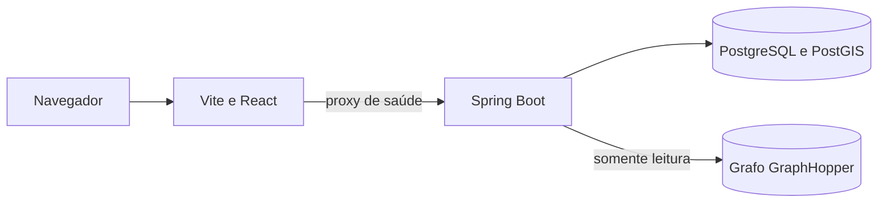
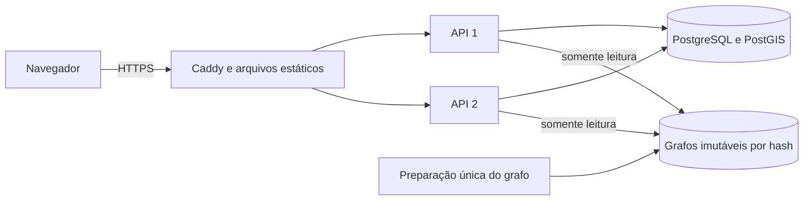

# Arquitetura

Bora mantém API, simulador e interface em um monorepo. O backend evolui como monolito modular,
com transações locais e fronteiras verificáveis. A base atual contém saúde operacional,
máquinas de estado, esquema PostGIS, histórico transacional e roteamento embutido. O simulador ainda
não executa cenários.

O Compose local prepara o grafo em um processo separado, inicia o banco e aguarda PostGIS antes
de iniciar a API e disponibilizar a web. A readiness inclui o banco e o grafo carregado com uma
rota de aquecimento aprovada. A liveness informa a saúde do processo sem depender desses dados.
Os health checks não expõem caminhos do grafo ou detalhes internos do banco.

## Evolução prevista

Os módulos `orders`, `couriers`, `dispatch` e `routing` contêm os primeiros contratos do domínio.
Entidades e escrita transacional de pedidos ficam em `orders.internal`; o teste Modulith
verifica as fronteiras. Os demais módulos serão introduzidos conforme seus comportamentos
existirem. O [guia de domínio](dominio.md) descreve estados, esquema e invariantes.

As decisões que orientam essa evolução são:

- Garantir exclusividade de ofertas e entregas com restrições e transações no PostgreSQL.
- Manter as posições persistidas como fonte compartilhada, com sequência ou instante de coleta
  para rejeitar atualizações antigas entre instâncias.
- Usar notificações do banco como aviso de mudança e recuperar o estado atual ao reconectar.
- Distinguir o cenário público simulado dos dados e ações pertencentes a cada visitante.
- Autorizar cada pedido e assinatura WebSocket conforme o acesso ao recurso.
- Permitir atualização gradual com migrações compatíveis e reconexão automática do tempo real.

Na implantação atual, duas APIs compartilham uma VM e um banco. Essa configuração permite
exercitar concorrência e atualizações graduais, mas a VM continua sendo um ponto único de falha.
Consumo de memória, latência, fluidez do mapa e comportamento durante atualizações serão medidos
com os cenários e as condições de teste registrados na documentação.

## Publicação

O ambiente de produção serve a web compilada pelo Caddy. Somente o proxy publica portas na VM;
as APIs compartilham uma rede com ele e outra com o banco, que não possui porta pública.

A troca de APIs acontece uma instância por vez, com drenagem e readiness. A web usa ativação
atômica de arquivos e preserva assets anteriores. O fluxo e os limites dessa recuperação estão
no [guia de publicação](deploy.md) e na [decisão de publicação gradual](decisoes/0002-publicacao-gradual.md).

O importador prepara e aquece o grafo antes de mudar o tráfego. Publica um diretório por hash,
mantendo versões anteriores para rollback. As APIs usam GraphHopper embutido e compartilham
esse volume somente para leitura; o cálculo não chama um serviço externo.
O [guia de roteamento](roteamento.md) descreve perfil, dados, ETA e medições.
