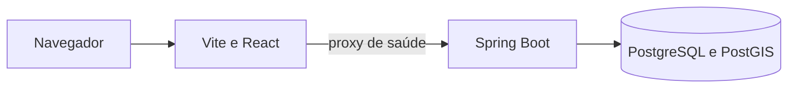
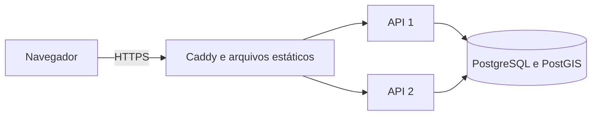

# Arquitetura

Bora mantém API, simulador e interface em um monorepo. O backend evolui como monolito modular,
com transações locais e fronteiras verificáveis. A base atual contém apenas o processo da API,
saúde operacional e a migração que habilita PostGIS. O simulador ainda não executa cenários.

O Compose local inicia o banco, aguarda a extensão PostGIS, inicia a API e só então disponibiliza
a web. A readiness da API inclui o banco. A liveness informa a saúde do processo sem depender
da disponibilidade do banco. Os detalhes internos do banco não são expostos pelo health HTTP.

## Evolução prevista

Os módulos de identidade, lojas, entregadores, pedidos, despacho, roteamento, rastreio, tempo
real, operação e demonstração serão introduzidos conforme seus comportamentos existirem.
Spring Modulith já está incluído para apoiar a verificação dessas fronteiras.

As decisões que orientam essa evolução são:

- Garantir exclusividade de ofertas e entregas com restrições e transações no PostgreSQL.
- Manter as posições persistidas como fonte compartilhada, com sequência ou instante de coleta
  para rejeitar atualizações antigas entre instâncias.
- Usar notificações do banco como aviso de mudança e recuperar o estado atual ao reconectar.
- Distinguir o cenário público simulado dos dados e ações pertencentes a cada visitante.
- Autorizar cada pedido e assinatura WebSocket conforme o acesso ao recurso.
- Permitir atualização gradual com migrações compatíveis e reconexão automática do tempo real.

Na implantação planejada, duas APIs compartilharão uma VM e um banco. Essa configuração permite
exercitar concorrência e atualizações graduais, mas a VM continua sendo um ponto único de falha.
Consumo de memória, latência, fluidez do mapa e comportamento durante atualizações serão medidos
com os cenários e as condições de teste registrados na documentação.

## Publicação

O ambiente de produção serve a web compilada pelo Caddy. Somente o proxy publica portas na VM;
as APIs compartilham uma rede com ele e outra com o banco, que não possui porta pública.

A troca de APIs acontece uma instância por vez, com drenagem e readiness. A web usa ativação
atômica de arquivos e preserva assets anteriores. O fluxo e os limites dessa recuperação estão
no [guia de publicação](deploy.md) e na [decisão de publicação gradual](decisoes/0002-publicacao-gradual.md).
