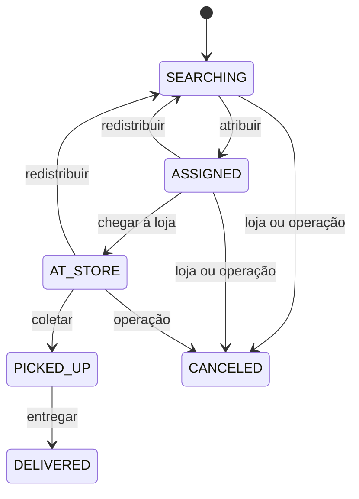

# Domínio e persistência

O esquema contém sete tabelas de negócio, criadas pelo Flyway. A demonstração começa com
uma área aproximada da região central de São Paulo e 40 lojas fictícias. O polígono serve
ao cenário de demonstração e não representa um limite administrativo oficial.

| Tabela            | Responsabilidade                            |
| ----------------- | ------------------------------------------- |
| `service_areas`   | Polígono da área atendida                   |
| `stores`          | Lojas e posições                            |
| `couriers`        | Disponibilidade, última posição e versão    |
| `orders`          | Atribuição vigente, estado, prazos e versão |
| `offers`          | Ofertas, respostas e vencimentos            |
| `order_events`    | Histórico de mudanças do pedido             |
| `delivery_tracks` | Posições de uma entrega no tempo            |

As posições usam `geography` com SRID 4326 e índices GiST. Coordenadas seguem a ordem
longitude, latitude; consultas geográficas como `ST_DWithin` recebem distâncias em metros.
O tipo da coluna também exige Point ou Polygon conforme o campo.

## Estados

As máquinas são interfaces seladas de Java, sem dependência de Spring ou da persistência.
Cada comando representa uma ação permitida, com rejeição explícita das demais combinações.



O entregador alterna entre `OFFLINE` e `AVAILABLE` quando está livre. Uma oferta reserva
o entregador em `OFFERED`; o aceite o leva a `BUSY`. Recusa, expiração ou cancelamento da
oferta liberam a reserva. Conclusão, cancelamento ou redistribuição do pedido liberam uma
entrega ativa. Ficar offline durante oferta ou entrega é rejeitado.

Uma oferta `PENDING` termina em `ACCEPTED`, `REJECTED`, `EXPIRED` ou `CANCELED`. Aceite e
recusa exigem instante estritamente anterior ao vencimento. A expiração vale a partir do
próprio vencimento; o cancelamento de uma oferta pendente também pode vencer essa corrida.
Estados terminais não têm novas transições.

## Transação e histórico

O módulo `orders` mantém entidades e serviço de escrita no pacote `internal`. O serviço
aceita comandos explícitos e a versão que o solicitante observou. JPA atualiza o pedido com
`@Version` e insere seu evento na mesma transação. Se a gravação do evento falhar, estado,
marcos de tempo e versão também são revertidos. Não há repetição automática de uma ação
que perdeu uma disputa de versão.

Cada transição aceita grava estado anterior, próximo estado, comando, versão e entregador,
quando existente. O ator é obrigatório; a autenticação futura fornecerá esse valor. A
redistribuição limpa a atribuição atual e os marcos daquela tentativa, mantendo o histórico.

O evento é imutável no JPA e protegido no PostgreSQL contra `UPDATE`, `DELETE` e `TRUNCATE`.
Seu JSON contém strings e números; UUIDs são strings. O mapper JSON do Hibernate está fixado
em Jackson 3, evitando mudança implícita quando outras bibliotecas trouxerem Jackson 2.

Flyway é o dono do esquema. Hibernate valida os mapeamentos sem criar ou alterar tabelas,
e o contexto de persistência não permanece aberto durante respostas HTTP. Outros módulos
usam IDs e contratos de domínio, sem acessar as entidades internas de pedidos.

## Garantias no banco

- Uma oferta pendente por pedido e por entregador, com índices únicos parciais.
- Uma entrega ativa por entregador, considerando `ASSIGNED`, `AT_STORE` e `PICKED_UP`.
- Entregador obrigatório em pedido atribuído, coletado ou entregue; ausente em `SEARCHING`.
- Estados conhecidos, versões e ETA não negativos, raio positivo e marcos de tempo coerentes.
- Referências válidas entre as tabelas, posições não vazias e eventos com objeto JSON válido.

Aceites anteriores permanecem em `offers`, inclusive após redistribuição. A atribuição vigente
fica em `orders.courier_id`: criar uma unicidade sobre todo o histórico `ACCEPTED` impediria
redistribuir legitimamente um pedido.

A reserva do entregador e a mudança coordenada de pedido e oferta serão transações do
despacho. Os índices garantem exclusividade, mas não sincronizam por conta própria o estado
das três tabelas. SQL direto futuro precisa incrementar `version` e evitar entidades JPA
desatualizadas no mesmo contexto. A limpeza por retenção exigirá um procedimento explícito
compatível com a proteção de eventos; exclusão em cascata não a contorna.

## Verificação

Com JDK 25 e Docker ativos, execute `./mvnw verify` ou `.\mvnw.cmd verify`. Os testes usam
PostgreSQL e PostGIS reais, com dados próprios, e cobrem:

- Matriz de comandos válidos e inválidos, limites de vencimento e restauração de estados.
- Aplicação das migrações, 40 lojas cobertas pelo polígono e tipos espaciais exatos.
- Violações de constraints identificadas por SQLSTATE e nome, além da proteção dos eventos.
- Concorrência entre transações, recuperação após falha de evento e controle otimista de versão.
- Consulta espacial com raio e ordenação por proximidade.

Na validação local do M02 em 18/10/2026, passaram 157 testes de estados e 93 verificações
de integração, sem falhas ou testes pulados. O conjunto anterior, que conhece somente V1,
também validou o banco já em V3 sem executar migrações adicionais ou apagar os dados iniciais.

Para conferir os dados iniciais no banco local já iniciado:

```sh
docker compose -f infra/compose/compose.dev.yml exec db psql -U bora -d bora
```

No `psql`:

```sql
SELECT count(*) AS lojas FROM stores WHERE simulated;

SELECT bool_and(ST_Covers(a.polygon, s.location)) AS todas_dentro
FROM stores s
JOIN service_areas a ON a.id = s.service_area_id;

SELECT version, success FROM flyway_schema_history WHERE version IS NOT NULL ORDER BY installed_rank;
```

O resultado esperado é 40 lojas, `t` em `todas_dentro` e as migrações 1, 2 e 3 aprovadas.
Quem usa credenciais próprias deve substituir banco e usuário. Para usar um `.env`, acrescente
`--env-file .env` antes de `-f`. A interface pública continua mostrando a saúde dos serviços;
os fluxos de criação e entrega serão disponibilizados nas etapas seguintes.
